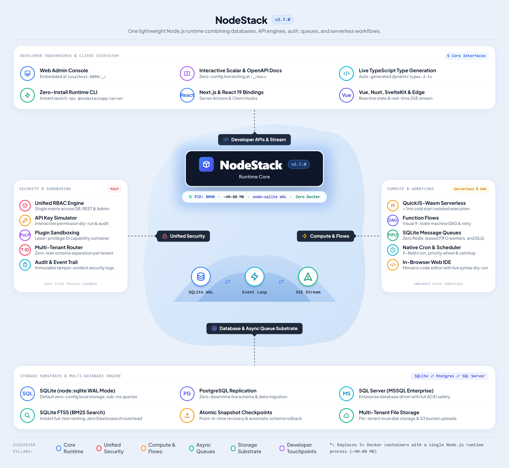
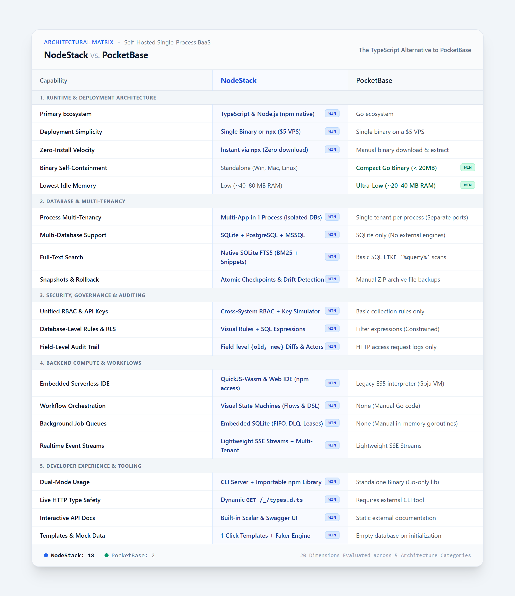

# NodeStack

> **The TypeScript-Native Multi-Application Backend Platform**  
> A self-hosted, single-process backend with embedded SQLite multi-tenancy, instant CRUD, Auth, Realtime SSE, Snapshots, Webhooks, and Themed Admin UI.

[](https://www.typescriptlang.org/)
[](https://nodejs.org/)
[](https://github.com/satya-jugran/nodestack/releases)
[](https://opensource.org/licenses/MIT)
[](https://satya-jugran.github.io/nodestack/)

<p align="center">
  <a href="https://codespaces.new/satya-jugran/nodestack?quickstart=1">
    
  </a>
  &nbsp;
  <a href="https://railway.com/new/template?template=https%3A%2F%2Fgithub.com%2Fsatya-jugran%2Fnodestack">
    
  </a>
</p>

https://github.com/user-attachments/assets/70eb11fa-9b68-4eb6-930d-ac367ebc4565

<p align="center">
  <a href="https://satya-jugran.github.io/nodestack/"><strong>Documentation</strong></a> ·
  <a href="https://satya-jugran.github.io/nodestack/getting-started/quick-start"><strong>Quick Start</strong></a> ·
  <a href="https://satya-jugran.github.io/nodestack/client-sdk/overview"><strong>Client SDK</strong></a> ·
  <a href="https://satya-jugran.github.io/nodestack/api-reference/rest-api"><strong>REST API</strong></a> ·
  <a href="./CHANGELOG.md"><strong>Changelog</strong></a>
</p>

---

## Why NodeStack?

Building modern web and mobile apps often requires managing external database servers, Redis caches, authentication microservices, and boilerplate CRUD route handlers.

NodeStack delivers an instant, complete backend stack in a **single Node.js process**:

<p align="center">
  
</p>

* **Built-in Job Scheduler & Cron Engine (v2.7.0)**: Recurring cron jobs and delayed task automation with standard 5-field syntax, macros, priority wake-up wheel, missed-run catchup policies, execution concurrency controls, and direct integration with Functions, Flows, and Snapshots.
* **Fail-Closed Multi-Database Resilience (v2.7.0)**: Automated partition protection preventing split-brain corruption when remote databases are unreachable, dynamic external driver resolution (`DriverPackageLoader`), and guarded SQLite migrations.
* **Zero-Compilation Embedded SQLite & Multi-Database Engine**: Powered natively by Node.js (`node:sqlite`) with first-class multi-database support for PostgreSQL and Microsoft SQL Server, zero-downtime migrations, and storage analytics.
* **Unified RBAC Engine & API Key Tester (v2.6.0)**: Granular role-based and scope-based authorization across collections, records, flows, and serverless functions with automatic wildcard stripping on role downgrades, atomic quota enforcement, and built-in interactive permission testing tools in Admin UI, CLI, and client SDK.
* **Hardened Plugin Sandboxing (PoLP) (v2.6.0)**: Principle of Least Privilege plugin DI containers, safe service token allowlists, tenant configuration isolation, and fault-tolerant EventBus error boundaries.
* **Multi-Application Platform**: Host multiple completely isolated application tenants within a single process—with separate SQLite databases, file storage directories, auth collections, realtime SSE buses, and 1-click app deletion.
* **Instant CRUD & Realtime SSE**: Automatically exposes REST endpoints and Server-Sent Events change streams for every collection.
* **Embedded Web Admin Dashboard**: A sleek, reactive dashboard served directly from `http://localhost:8090/_/` without needing an external web server.
* **Native SQLite FTS5 Full-Text Search**: High-performance BM25 relevance scoring, prefix queries, and highlighted snippet excerpts without external search services.
* **Embedded Serverless Functions**: Sandboxed QuickJS-Wasm JavaScript/TypeScript lambda execution with sub-millisecond cold starts, Anti-SSRF network firewalls, direct HTTP routes, database lifecycle hooks, and dedicated CodeMirror IDE workbench.
* **Serverless Function Flows**: Visual state machine orchestration engine with drag-and-drop designer, declarative Code DSL, 9 state types (Task, Choice, Map, Parallel, Loop, Pass, Wait), database lifecycle event triggers, flow execution concurrency limits, and function-flow referential integrity protection.
* **NodeStack Queues Subsystem (v2.4)**: Transactional SQLite-backed message queuing with atomic claiming, configurable retries, dead-letter queues (DLQ), strict partition FIFO ordering, serverless function binding, and dedicated Admin UI queues manager.
* **Outbound Webhooks Engine**: Event-driven HTTP callbacks with HMAC-SHA256 signature verification and automated retries.
* **Immutable Audit Logs**: Field-level `{ old, new }` diff computation, actor attribution, sensitive field masking, and visual record timeline.
* **Built-in Auth & File Storage**: JWT tokens, bcrypt password hashing, auth collections (`users`), and multipart file uploads with MIME validation.
* **End-to-End Type Safety**: One-command type generation (`nodestack typegen`) and live HTTP type exports (`GET /_/types.d.ts`).
* **First-Party Client SDK (`nodestack-client`)**: Lightweight (<10KB), zero-dependency TypeScript/JavaScript client for web apps, React, Next.js, React Native, Node.js, Bun, and Deno.
* **Full TypeScript Extensibility**: Write server lifecycle hooks, custom routes, and business logic with direct access to npm.

---

## Comparison: NodeStack vs. PocketBase

<p align="center">
  
</p>

<details>
  <summary><strong>Click to expand accessible data table (20 Dimensions)</strong></summary>


> **Legend**: Exactly **one bold cell per row** indicates the standout category leader for that specific dimension.

| Feature / Dimension | 🚀 **NodeStack** | 📦 **PocketBase** |
| :--- | :--- | :--- |
| **1. RUNTIME & DEPLOYMENT ARCHITECTURE** | | |
| **Primary Ecosystem** | **TypeScript & Node.js (npm native)** | Go ecosystem |
| **Deployment Simplicity** | **Single binary or `npx` ($5 VPS)** | Single binary on a $5 VPS |
| **Zero-Install CLI Velocity** | **Instant via `npx` (Zero downloads needed)** | Manual binary download & extract |
| **Binary Self-Containment** | Standalone Binary (Win, macOS, Linux) | **Ultra-Compact Binary (< 20MB Go)** |
| **Lowest Resource Footprint** | Low (~40–80 MB RAM) | **Ultra-Low (~20–40 MB RAM)** |
| **2. DATABASE & MULTI-TENANCY** | | |
| **Process Multi-Tenancy** | **Native Multi-App in 1 Process (Isolated DBs)** | Single tenant per process (Separate ports) |
| **Multi-Database Support** | **SQLite + PostgreSQL + MSSQL** | SQLite only (No external engines) |
| **Embedded Full-Text Search** | **Native SQLite FTS5 (BM25 + Snippets)** | Basic SQL `LIKE '%query%'` scans |
| **Application Snapshots & Rollback** | **Atomic checkpoints, drift detection & 1-click restore** | Manual ZIP archive file backups |
| **3. SECURITY, GOVERNANCE & AUDITING** | | |
| **Unified RBAC & Key Security** | **Cross-System RBAC + Key Simulator** | Basic collection rules only |
| **Database-Level Rules & RLS** | **Visual Rules + Custom SQL Expressions** | Filter expressions (Constrained) |
| **Immutable Audit Trail** | **Field-level `{ old, new }` diffs & actor attribution** | HTTP access request logs only |
| **4. BACKEND COMPUTE & WORKFLOWS** | | |
| **Embedded Serverless IDE** | **QuickJS-Wasm (Sub-ms cold starts & Web IDE)** | Legacy ES5 interpreter (Goja VM) |
| **Workflow Orchestration** | **Embedded Visual State Machines (Flows & DSL)** | None (Manual Go code) |
| **Background Job Queues** | **Embedded SQLite (FIFO, DLQ, Functions)** | None (Manual in-memory goroutines) |
| **Realtime Event Streams** | **Lightweight SSE Streams + Multi-Tenant** | Lightweight SSE Streams |
| **5. DEVELOPER EXPERIENCE & TOOLING** | | |
| **Dual-Mode Usage** | **Standalone CLI + Importable npm Library** | Standalone Binary (Go-only library) |
| **Live HTTP Type Safety** | **Live dynamic `GET /_/types.d.ts` endpoint** | Requires external CLI tool (`pocketbase-typegen`) |
| **Interactive API Documentation** | **Built-in Scalar & Swagger UI (`/_/docs`)** | Static external documentation |
| **Starter Templates & Mock Data** | **1-Click templates (E-comm, CRM) + Faker engine** | Empty database on initialization |

</details>

### When to Choose What

* **Choose NodeStack if:** You want the simplicity of a single-process embedded backend, but your team builds in **TypeScript & Node.js**. You get instant access to the **npm ecosystem**, **zero-install `npx` startup**, **isolated multi-app tenancy in one process**, **atomic state snapshots**, **embedded background queues**, **unified RBAC authorization & key simulation**, and **embedded FTS5 search & Wasm serverless lambdas**.
* **Choose PocketBase if:** Your priority is absolute raw binary minimalism (<20MB single Go binary) and the lowest possible idle memory footprint (~20MB RAM).
* **Choose Supabase if:** You need multi-terabyte enterprise PostgreSQL with complex relational models, pgvector, in-kernel RLS, and bidirectional WebSockets presence.

---

## Quick Start

### 0. 1-Click "Try in Browser" (Zero Local Setup)

Devs hate cloning repos just to try them. Launch NodeStack immediately without touching your terminal:

* **[Open in GitHub Codespaces](https://codespaces.new/satya-jugran/nodestack?quickstart=1)**: Boots a dedicated Node.js 24 cloud VM with VS Code in your browser, compiles the server, and automatically pops open the Admin UI (`http://localhost:8090/_/`) in an embedded preview.
* **[Deploy on Railway](https://railway.com/new/template?template=https%3A%2F%2Fgithub.com%2Fsatya-jugran%2Fnodestack)**: 1-click cloud deploy with persistent volume storage for your embedded SQLite database (`nodestack_data`).

---

### 1. Launch with NPX (Instant Backend)

```bash
npx @nodestackapp/server start
```

Visit **`http://localhost:8090/_/`** to complete the first-time admin setup and start designing your schema.

### 2. Create an Admin / Superuser via CLI

```bash
npx @nodestackapp/server superuser create admin@example.com MySecretPassword123!
```

---

## Programmatic TypeScript SDK

NodeStack is also an importable framework that integrates into your application:

```typescript
import { NodeStack } from '@nodestackapp/server';

const app = new NodeStack({
  dataDir: './nodestack_data',
  port: 8090,
});

// Intercept record creation
app.onRecordBeforeCreate('posts', async (event) => {
  const { record } = event;
  if (!record.title) {
    throw new Error('Title cannot be blank');
  }
  record.slug = record.title.toLowerCase().replace(/[^a-z0-9]+/g, '-');
});

// Custom REST API endpoint
app.router.get('/api/health', async () => {
  return { status: 'healthy', uptime: process.uptime() };
});

await app.start();
```

---

## First-Party Client SDK (`nodestack-client`)

Connect frontend applications to NodeStack with zero external dependencies:

```bash
npm install nodestack-client
```

```typescript
import NodeStackClient from 'nodestack-client';

const client = new NodeStackClient('http://localhost:8090');

// 1. Authenticate
await client.collection('users').authWithPassword('user@example.com', 'secret');

// 2. Query with FTS5 Full-Text Search & BM25 Scoring
const results = await client.collection('posts').getList(1, 10, {
  search: 'distributed systems',
  snippetTag: 'mark',
});

// 3. Multi-Application Scoping (v2.0)
const shopClient = client.app('shop'); // Automatically scopes headers, SSE, and file URLs
const products = await shopClient.collection('products').getList(1, 10);

// 4. Realtime Server-Sent Events (SSE)
client.collection('posts').subscribe('*', (event) => {
  console.log('Post changed:', event.action, event.record);
});
```

---

## 🛒 Example Applications

### Official React E-Commerce Storefront (`examples/ecommerce-react`)

A modern, full-featured retail storefront showcasing NodeStack's multi-tenancy, authentication, instant CRUD, and real-time capabilities:

* **Authentication & Profiles**: Registration, JWT sessions with `LocalAuthStore`, and 1-click demo login (`alex.vance@nodestack.dev`).
* **Product Catalog & Images**: 20 products across 5 categories with SVG hero imagery served directly via NodeStack file storage.
* **Faceted Search & Filters**: Live search, category pills, price range, in-stock filters, and dynamic star rating computation.
* **Wishlist / Favorites**: Real-time heart toggles synced to the backend `favorites` collection.
* **Cart & Checkout**: Slide-out cart drawer, free shipping threshold progress meter, and order submission to the `orders` collection.
* **Order Tracking & Reviews**: Visual status stepper (`Pending` → `Processing` → `Shipped` → `Delivered`) and verified buyer review forms with live average score updates.
* **Multi-App Scoping**: Configure `VITE_NODESTACK_APP` in `.env.local` to connect seamlessly to isolated tenant databases.

```bash
# 1. Start the NodeStack backend with e-commerce template (Port 8090)
# Instant NPX (no cloning required):
npx @nodestackapp/server start --template ecommerce

# Or locally from this repo:
npm run demo:backend

# 2. Start the React storefront (Port 5173 - requires cloning repo)
npm run demo:frontend
```

---

## Documentation

Full documentation, guides, and tutorials are available on the [Official Documentation Portal](https://satya-jugran.github.io/nodestack/):

| Guide | Description |
| :--- | :--- |
| [**Comparison Matrix**](https://satya-jugran.github.io/nodestack/getting-started/comparison) | Objective architectural comparison with PocketBase and Supabase. |
| [**Overview & Architecture**](https://satya-jugran.github.io/nodestack/getting-started/overview) | Single-process architecture, storage engine, and design principles. |
| [**Quick Start**](https://satya-jugran.github.io/nodestack/getting-started/quick-start) | Step-by-step setup in under 60 seconds. |
| [**Collections & Schema**](https://satya-jugran.github.io/nodestack/core-concepts/collections) | Field types, validation, and automated schema inference. |
| [**SQLite FTS5 Search**](https://satya-jugran.github.io/nodestack/core-concepts/fts5-search) | Embedded BM25 relevance scoring and snippet highlighting. |
| [**Visual Access Rules**](https://satya-jugran.github.io/nodestack/core-concepts/access-rules) | Row-level security model and the visual clause builder. |
| [**Multi-Application Platform**](https://satya-jugran.github.io/nodestack/core-concepts/multi-application) | Multi-tenancy, isolated SQLite databases, asset storage, and app scoping. |
| [**Auth & Security**](https://satya-jugran.github.io/nodestack/auth-and-security/authentication) | JWT tokens, bcrypt password hashing, and session revocation. |
| [**Immutable Audit Logs**](https://satya-jugran.github.io/nodestack/auth-and-security/audit-logging) | Field-level diff computation, actor attribution, and timeline drawer. |
| [**Realtime SSE**](https://satya-jugran.github.io/nodestack/realtime/realtime-sse) | Server-Sent Events engine and topic subscriptions. |
| [**Outbound Webhooks**](https://satya-jugran.github.io/nodestack/webhooks/outbound-webhooks) | Automated HTTP callbacks and HMAC-SHA256 signature verification. |
| [**Server SDK & Hooks**](https://satya-jugran.github.io/nodestack/typescript-sdk/lifecycle-hooks) | Database lifecycle hooks and custom Fastify route extensions. |
| [**Client SDK**](https://satya-jugran.github.io/nodestack/client-sdk/overview) | Complete `nodestack-client` usage guide and TypeScript typegen. |
| [**REST API Reference**](https://satya-jugran.github.io/nodestack/api-reference/rest-api) | Interactive Scalar/Swagger UI API docs and OpenAPI 3.0 spec. |
| [**Docker & Deployment**](https://satya-jugran.github.io/nodestack/deployment/docker) | Dockerfile, Docker Compose, systemd unit, and reverse proxies. |

---

## License

MIT © [NodeStack Contributors](https://github.com/satya-jugran/nodestack)
