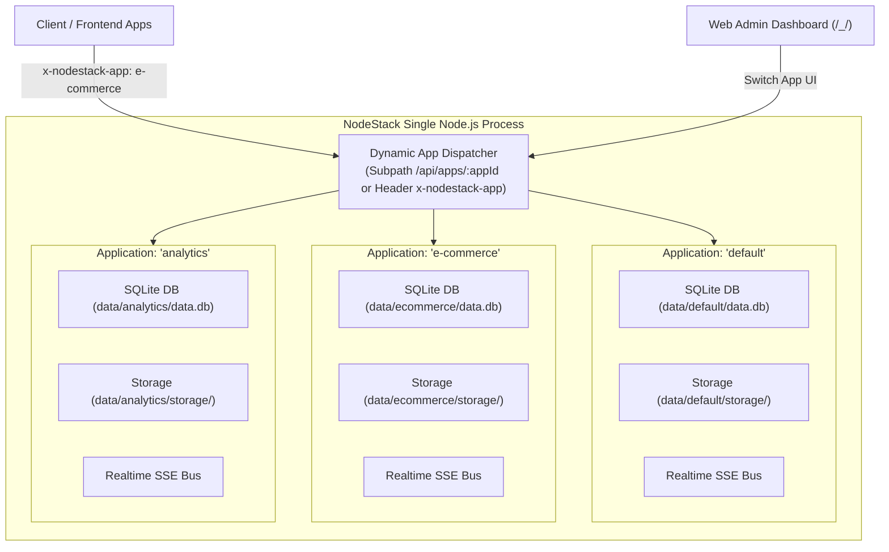

# Multi-Application Platform

NodeStack v2.0 introduces native **Multi-Application Support**. A single NodeStack server process can host, isolate, and manage multiple independent applications simultaneously.

Each application functions as a completely isolated tenant with its own embedded SQLite database, file storage directory, authentication user pools, realtime Server-Sent Events (SSE) bus, audit logs, and webhooks.



---

## Architectural Isolation Guarantees

Every tenant in NodeStack is isolated across all 10 core backend subsystems:

| Subsystem | Isolation Level | Details |
| :--- | :--- | :--- |
| **Embedded Database** | **Physical File Isolation** | Each app receives a separate SQLite database file (`data/<app-id>/data.db`) with its own WAL journal and triggers. |
| **File Storage** | **Directory Isolation** | Uploaded media, attachments, and protected files are stored in `data/<app-id>/storage/`. |
| **Authentication & Users** | **Scoped Auth Collections** | User tables, password hashes, and JWT signatures are scoped strictly per application. |
| **Realtime SSE** | **Isolated Event Bus** | Realtime SSE event streams (`/api/realtime?app=:slug`) broadcast mutations exclusively to connected clients of that app. |
| **Audit Logs** | **Independent Audit Trail** | Record diffs and mutation histories are maintained in each app's dedicated `_audit_logs` collection. |
| **Outbound Webhooks** | **App-Scoped Triggers** | Webhook targets, delivery attempt histories, and HMAC signing keys are isolated per application. |
| **Search Indexes (FTS5)** | **Isolated Virtual Tables** | FTS5 full-text indices and BM25 ranking tables are created within each app's SQLite instance. |
| **Starters & Templates** | **Per-App Initializers** | Applications can be initialized with pre-built schemas (e.g. E-Commerce, Blog, SaaS) or as blank apps. |

---

## App Resolution & Routing

Clients can interact with specific applications using three intuitive mechanisms:

### 1. HTTP Request Header (`x-nodestack-app`)
Recommended for REST and GraphQL clients, mobile apps, and frontend web applications:

```http
GET /api/collections/posts/records HTTP/1.1
Host: localhost:8090
x-nodestack-app: e-commerce
```

### 2. URL Path Scoping (`/api/apps/:appId/...`)
Ideal for static assets, webhook callbacks, or explicit REST resource routing:

```http
GET /api/apps/e-commerce/collections/posts/records HTTP/1.1
Host: localhost:8090
```

### 3. Query Parameter (`?app=:appId`)
Used for Server-Sent Events (SSE) connections where browser `EventSource` does not support custom request headers:

```http
GET /api/realtime?app=e-commerce HTTP/1.1
Host: localhost:8090
```

> [!NOTE]
> **Backward Compatibility**: If no application header or path prefix is provided, NodeStack automatically routes the request to the `default` application. Existing single-app deployments upgrade seamlessly to v2.0 with zero configuration changes.

---

## Web Admin UI Experience

The embedded NodeStack Admin Dashboard (`http://localhost:8090/_/`) features full multi-app management:

### 1. App Switcher
Located prominently in the top navigation bar. Click the app selector dropdown to instantly switch between active applications. All collections, records, schemas, webhooks, and audit logs update immediately for the selected app.

### 2. Creating an App
Click **"Create New App"** in the dropdown or press `Ctrl + K` / `Cmd + K` to open the Command Palette:
1. Enter an **Application Name** (e.g., `Shop Portal`).
2. Enter a **Slug** (e.g., `shop-portal` or custom identifier).
3. Select an optional **Starter Template** (e.g., `Blank`, `Blog / CMS`, `E-Commerce`, or `SaaS Starter`).

### 3. 1-Click Delete App
To delete an application:
1. Open the App Switcher dropdown.
2. Click the trash icon button next to any non-default application.
3. Confirm the deletion prompt.
NodeStack immediately unregisters the app, flushes WAL logs, deletes the database and file storage directory, and safely redirects the admin view back to the `default` app.

> [!IMPORTANT]
> The `default` application is protected and cannot be deleted, ensuring your primary administrative instance always remains intact.

---

## Client SDK (`nodestack-client`)

The `nodestack-client` SDK provides first-class support for multi-application environments through the `client.app(slug)` API and `client.apps` management service.

### Scoping Requests to an Application

Use `client.app(slug)` to create a scoped client instance. All subsequent record queries, file URL builders, and realtime subscriptions automatically target that app:

```typescript
import NodeStackClient from 'nodestack-client';

const client = new NodeStackClient('http://localhost:8090');

// Create an app-scoped client instance
const shopClient = client.app('shop');

// 1. Authenticate within the 'shop' app
await shopClient.collection('users').authWithPassword('customer@example.com', 'secret123');

// 2. Query collections in 'shop'
const products = await shopClient.collection('products').getList(1, 20);

// 3. Build file URLs scoped to 'shop'
const imageUrl = shopClient.files.getUrl(products.items[0], products.items[0].thumbnail);
// Returns: http://localhost:8090/api/apps/shop/files/products/rec_123/thumbnail.png

// 4. Scoped Realtime SSE
shopClient.collection('orders').subscribe('*', (event) => {
  console.log('Shop order update:', event.action, event.record);
});
```

### Managing Applications Programmatically (`client.apps`)

Superusers and administrative scripts can manage applications using `client.apps`:

```typescript
// Authenticate as superuser / admin
await client.admins.authWithPassword('admin@nodestack.io', 'AdminPassword123');

// 1. List all hosted applications
const appsList = await client.apps.getList(1, 50);
console.log('Active applications:', appsList.items);

// 2. Create a new application
const newApp = await client.apps.create({
  name: 'Mobile App Backend',
  slug: 'mobile-app',
  template: 'saas',
});

// 3. Update an application's details
await client.apps.update(newApp.id, {
  name: 'Mobile App Production',
});

// 4. Delete an application (deletes DB, storage, and unloads tenant)
await client.apps.delete(newApp.id);
```

---

## REST API Reference

The Application Management REST API is served under `/api/apps`:

| Method | Endpoint | Description | Superuser Only |
| :--- | :--- | :--- | :--- |
| `GET` | `/api/apps` | List all applications with pagination and metadata | Yes |
| `POST` | `/api/apps` | Provision a new application from template | Yes |
| `GET` | `/api/apps/:id` | Retrieve application details by ID or slug | Yes |
| `PATCH` | `/api/apps/:id` | Update application name, metadata, or status | Yes |
| `DELETE` | `/api/apps/:id` | Delete application, SQLite database, and file storage | Yes |

### Scoped Collection Endpoints

All standard collection endpoints can be addressed directly by prefixing with `/api/apps/:appId/`:

```http
# List records in the 'blog' app
GET /api/apps/blog/collections/posts/records

# Create a record in the 'shop' app
POST /api/apps/shop/collections/orders/records

# Authenticate user in the 'client-portal' app
POST /api/apps/client-portal/collections/users/auth-with-password
```
