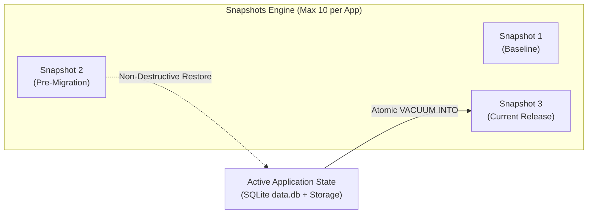

# Application Snapshots & Checkpoints

NodeStack v2.0 introduces **Application Snapshots & Checkpoints** via `SnapshotService`. A snapshot captures a self-contained, point-in-time state of an application—combining its embedded SQLite database, uploaded media assets, schema definitions, and cryptographic content hashes.

Snapshots provide time-travel recovery across development, demo presentations, integration testing, and production maintenance workflows.



---

## Architectural Guarantees

Every snapshot created by NodeStack guarantees:

1. **Atomic Transactional Database Snapshot**: Uses SQLite's native `VACUUM INTO` command, capturing a consistent, uncorrupted database copy without downtime or table locks.
2. **Media & File Asset Synchronization**: Copies uploaded assets from `storage/` alongside the database, ensuring uploaded images and documents match the exact record state.
3. **Deterministic Schema & Content Hashing**: Computes SHA-256 hashes of collection schemas and database content to dynamically detect state drift from the active snapshot.
4. **Non-Destructive Time-Travel**: Restoring to an older snapshot preserves all subsequent checkpoints, allowing you to move forward and backward across different states at will.
5. **Multi-Tenant Isolation**: In multi-application environments, snapshots are strictly scoped per application tenant (`/api/apps/:appId/snapshots`).

---

## Capacity Limit & FIFO Eviction Safeguard

To prevent unbounded disk usage, NodeStack enforces a hard limit of **10 snapshots per application**:

* Attempting to create an 11th snapshot without confirmation rejects with **HTTP 409 Conflict** (`SNAPSHOT_LIMIT_REACHED`).
* Callers can pass `evictOldest: true` (or `--evict-oldest` in CLI) to safely purge the oldest snapshot before saving the new checkpoint.
* The Admin UI displays an interactive capacity warning with metadata of the snapshot to be replaced before prompting confirmation.

---

## Web Admin Dashboard

The Snapshots view in the Admin UI (`http://localhost:8090/_/`):

* Displays active baseline status and live database drift indicators.
* Visualizes chronological checkpoint history with record counts, storage sizes, and creation timestamps.
* Provides 1-click non-destructive restoration with safety confirmation modals.
* Seamlessly switches histories when changing the active tenant in the Multi-App switcher.

---

## Client SDK (`nodestack-client`)

The `client.snapshots` service provides complete programmatic control:

```typescript
import NodeStackClient from 'nodestack-client';

const client = new NodeStackClient('http://localhost:8090');

// Authenticate as superuser / admin
await client.admins.authWithPassword('admin@example.com', 'AdminPassword123!');

// 1. Create a snapshot checkpoint
const snapshot = await client.snapshots.create({
  label: 'Pre-Deployment Baseline',
  description: 'Clean database state before running schema migrations',
  evictOldest: true, // Auto-evict oldest if at 10-snapshot capacity
});

// 2. List all snapshots & monitor drift
const status = await client.snapshots.list();
console.log(`Retained snapshots: ${status.snapshots.length}/10`);
console.log(`Has data drifted: ${status.driftDetected}`);

// 3. Restore to checkpoint
await client.snapshots.restore(snapshot.id);

// 4. Delete an individual checkpoint
await client.snapshots.delete(snapshot.id);
```

### Application-Scoped Snapshots

When managing a tenant application, use `client.app(slug).snapshots`:

```typescript
const shopClient = client.app('shop');
const shopSnapshots = await shopClient.snapshots.list();
```

---

## CLI Commands

You can manage checkpoints directly from your terminal:

```bash
# List all snapshots and drift status
npx @nodestackapp/server snapshots list

# Create a new snapshot checkpoint
npx @nodestackapp/server snapshots create --label "Pre-Update" --description "Catalog backup"

# Force oldest eviction if at the 10-snapshot limit
npx @nodestackapp/server snapshots create --label "Nightly" --evict-oldest

# Restore to a specific snapshot ID
npx @nodestackapp/server snapshots restore <snapshot-id>

# Delete a specific snapshot
npx @nodestackapp/server snapshots delete <snapshot-id>

# Clear all snapshots
npx @nodestackapp/server snapshots clear
```
