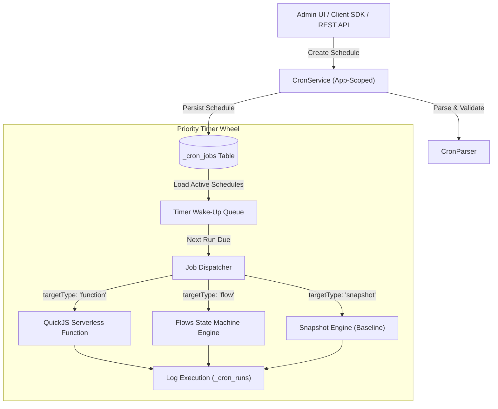

# Scheduler & Cron Engine

NodeStack includes an embedded, high-reliability **Job Scheduler & Cron Engine**. It enables recurring and delayed task automation directly inside your application—without requiring external cron daemons, system crontabs, or third-party queue infrastructure like Redis or Celery.

---

## Why Built-in Scheduling?

Modern applications rely on recurring tasks for background maintenance, synchronization, and business workflows:
* **Periodic Cleanup & Archival**: Purging expired sessions, cleaning audit logs, and running database vacuum routines.
* **Recurring Workflow Triggers**: Triggering visual **Function Flows** daily at midnight for billing reconciliation or nightly analytics aggregation.
* **Serverless Task Invocation**: Executing scheduled **Serverless Functions** with custom payloads on a cron cadence.
* **Automated Point-in-Time Checkpoints**: Automatically generating periodic **Snapshots** for disaster recovery and rollback baselines.
* **Outbound Webhook Dispatches**: Pinging external endpoints or health checks on recurring intervals.

NodeStack Scheduler provides:
* **Zero Infrastructure Footprint**: Runs in-process with persistent state stored in system tables (`_cron_jobs` and `_cron_runs`) with full ACID guarantees.
* **Universal 5-Field Cron Parser**: Standard syntax with support for intervals, ranges, lists, step values (`*/n`), and convenient macro shortcuts (`@hourly`, `@daily`, `@weekly`, `@monthly`, `@yearly`).
* **Priority Wake-Up Wheel**: Next execution timestamps are evaluated and scheduled with efficient timer sleep, avoiding CPU polling loops.
* **Missed-Run Policies**: Choose how the scheduler behaves after a server reboot or downtime (`skip`, `catch_up_once`, or `catch_up_all`).
* **Multi-Target Dispatch**: Schedule serverless Functions (or inline JavaScript lambdas), visual Flows, or atomic Snapshots.
* **Execution History & Metrics**: Full run logging with status tracking (`running`, `succeeded`, `failed`, `skipped`), latency metrics, error stack traces, and manual execution triggers.
* **Multi-Tenant Isolation**: Schedules and run histories are isolated per tenant application (`/api/apps/:slug/cron`).

---

## Architecture & Execution Model



### Storage Model

NodeStack persists schedules and run logs in internal database tables:
* `_cron_jobs`: Stores the schedule definitions, target bindings, cron expression, timezone, missed run policy, and state tracking counters.
* `_cron_runs`: Records individual execution instances with timestamps, status, duration, output, and failure diagnostics.

---

## Cron Syntax & Supported Macros

The scheduler accepts standard 5-field cron expressions:

```text
┌────────────── minute (0 - 59)
│ ┌──────────── hour (0 - 23)
│ │ ┌────────── day of month (1 - 31)
│ │ │ ┌──────── month (1 - 12)
│ │ │ │ ┌────── day of week (0 - 7) (0 and 7 are both Sunday)
│ │ │ │ │
* * * * *
```

### Supported Special Characters
* `*` : Any value (wildcard).
* `,` : Value list separator (e.g., `1,15,30`).
* `-` : Value range (e.g., `9-17`).
* `/` : Step intervals (e.g., `*/15` for every 15 minutes).

### Standard Macro Shortcuts
For convenience, NodeStack supports standard macro expressions:
* `@yearly` or `@annually` : Run once a year at midnight on January 1st (`0 0 1 1 *`).
* `@monthly` : Run once a month at midnight on the first day (`0 0 1 * *`).
* `@weekly` : Run once a week at midnight on Sunday (`0 0 * * 0`).
* `@daily` or `@midnight` : Run once a day at midnight (`0 0 * * *`).
* `@hourly` : Run once an hour at the start of the hour (`0 * * * *`).

---

## Missed-Run Handling

When your server is stopped, rebooted, or network partitions occur, scheduled runs may be missed. NodeStack gives you explicit control over recovery behavior via `missedRunPolicy`:

| Policy | Behavior | Best Used For |
| :--- | :--- | :--- |
| `skip` | Silently ignores missed execution slots. Only the next future execution will run. | Non-critical tasks, telemetry pings, cache refreshes. |
| `catch_up_once` | Executes exactly one catch-up run immediately upon startup, then resumes standard cadence. | Daily digest emails, summary rollups, snapshot baselines. |
| `catch_up_all` | Sequentially executes every missed slot that occurred during downtime. | Financial ledgers, batch syncs where every discrete window matters. |

---

## Multi-Target Execution

Each scheduled job can target one of three core subsystems:

### 1. Serverless Functions (`function`)
Invokes a registered QuickJS WebAssembly function or an inline JavaScript snippet. The job payload is passed into the function's `context.payload`:
```json
{
  "targetType": "function",
  "targetId": "daily-report-generator",
  "payload": { "format": "pdf", "notify": true }
}
```

### 2. Visual Flows (`flow`)
Dispatches a visual state machine workflow in the **Function Flows** engine. Ideal for multi-step orchestrations with conditional branching and external integrations:
```json
{
  "targetType": "flow",
  "targetId": "nightly-backup-and-sync-flow",
  "payload": { "dryRun": false }
}
```

### 3. Application Snapshots (`snapshot`)
Automatically creates an atomic, point-in-time state checkpoint of your SQLite database schema and records:
```json
{
  "targetType": "snapshot",
  "name": "Hourly Snapshot Baselines",
  "cronExpression": "0 * * * *",
  "keepLast": 24
}
```

---

## RBAC Authorization & API Key Scopes

The scheduler is fully integrated with NodeStack's Unified RBAC Engine. Dedicated permission scopes allow fine-grained access delegation:

* `cron:read`: View schedules, inspect run histories, and preview cron timings.
* `cron:write`: Create, edit, pause, and delete schedules.
* `cron:run`: Trigger immediate on-demand schedule executions (`POST /api/cron/schedules/:id/trigger`).
* `cron:*`: Full administrative access across all cron management endpoints.
