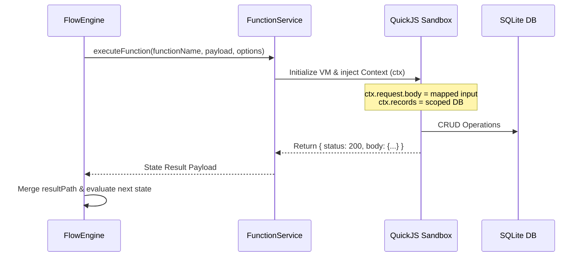
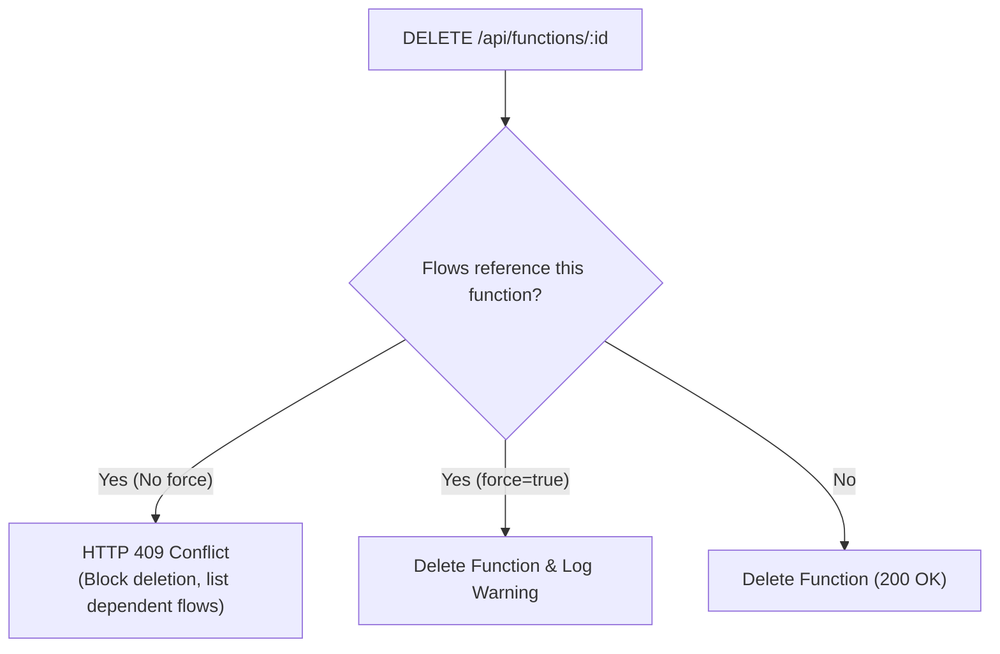

# Serverless Function Integration & Referential Integrity

Function Flows and Serverless Functions are tightly coupled in NodeStack. Flows act as the orchestration layer, while serverless functions provide the individual units of business logic.

---

## How `Task` States Invoke Functions

When a flow reaches a `Task` state, the `FlowEngine` delegates execution to NodeStack's `FunctionService`:



### Context Mapping (`ctx`)

The data passed to the function's `ctx` context is shaped by the state's `inputPath`:

```javascript
// Function: calculate-tax
export default async function(ctx) {
  // ctx.request.body receives the payload selected by the Task state's inputPath
  const { amount, stateCode } = ctx.request.body;

  const taxRates = { CA: 0.0825, NY: 0.08875, TX: 0.0625 };
  const rate = taxRates[stateCode] || 0.05;
  const tax = Number((amount * rate).toFixed(2));

  return {
    status: 200,
    body: {
      rate,
      taxAmount: tax,
      totalWithTax: amount + tax
    }
  };
}
```

The returned `body` object is then stored in the flow's context at the position defined by `resultPath`.

---

## Elevated Privileges & Service Roles

By default, functions invoked by a flow inherit standard access rule boundaries. However, flows orchestrating background jobs or privileged administrative operations can elevate privileges:

```json
{
  "type": "Task",
  "function": "generate-monthly-report",
  "elevated": true,
  "serviceRole": true,
  "next": "DeliverReport"
}
```

* **`elevated: true`**: Grants the function permission to bypass collection-level read/write rules when using `ctx.records`.
* **`serviceRole: true`**: Identifies the caller as `serviceRole: true` within `ctx.request.auth`, allowing internal system actions.

---

## Referential Integrity Protection

To prevent broken production workflows, NodeStack enforces **referential integrity** between Serverless Functions and Function Flows.

### The Problem
If a developer deletes a serverless function (e.g. `charge-card`) while one or more active flows (e.g. `order-checkout`) still reference it in a `Task` state, subsequent flow executions would crash at runtime with `FunctionNotFoundError`.

### The NodeStack Solution: Fail-Closed Dependency Inspection
Before deleting any serverless function, NodeStack performs a fail-closed inspection of all registered flows (including nested states within `Map` iterators and `Parallel` branches) across tenant applications.



### 1. Default Behavior (409 Conflict)
Attempting to delete a function that is actively referenced by one or more flows is blocked:

```http
DELETE /api/functions/calculate-shipping
```

**Response (`HTTP 409 Conflict`)**:
```json
{
  "status": 409,
  "message": "Cannot delete function 'calculate-shipping': it is referenced by 2 active flow(s): 'e-commerce-checkout' (flow_01), 'bulk-shipping-pipeline' (flow_02). Pass ?force=true to delete anyway."
}
```

### 2. Force Override (`?force=true`)
If you intentionally want to delete the function despite active flow dependencies, pass the `?force=true` query parameter:

```http
DELETE /api/functions/calculate-shipping?force=true
```

**Response (`HTTP 200 OK`)**:
```json
{
  "message": "Function 'calculate-shipping' deleted (forced)"
}
```

> [!WARNING]
> Force deleting a function will leave referencing flows in an unresolvable state. Any flow step attempting to execute the missing function will fail with `FunctionNotFoundError` during runtime.

---

## Admin UI Safety Dialogs

When you delete a function in the NodeStack Admin Portal (`/_/functions`):

1. **Clean Deletion**: If no flows reference the function, a standard confirmation modal appears.
2. **Conflict Warning Modal**: If flows reference the function, the Admin UI displays an amber warning banner detailing all dependent flows by name and ID. The primary action button switches to a high-contrast **"Force Delete Anyway"** button with clear risk messaging.
