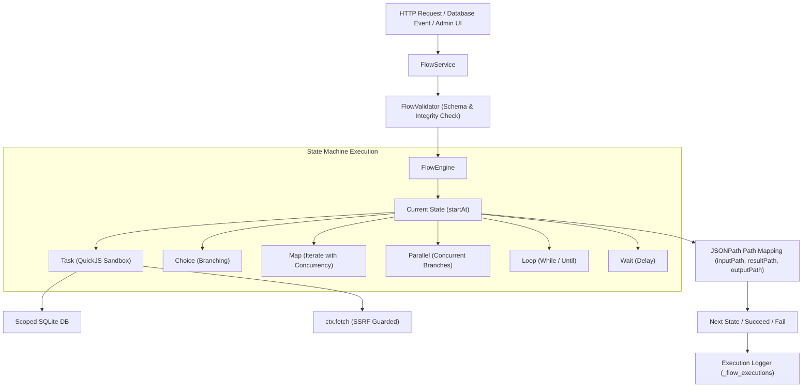

# Function Flows (Workflow Orchestration)

NodeStack includes an embedded, high-performance **Function Flows** orchestration subsystem. It allows you to coordinate multiple serverless functions, conditional decisions, parallel executions, and database events into robust, stateful workflows—without external dependencies like AWS Step Functions, Temporal, or Airflow.

---

## Why In-Engine Workflow Orchestration?

When building modern applications, individual serverless functions often need to be chained together:

* **E-Commerce Order Processing**: Validate cart &rarr; Charge payment &rarr; Deduct inventory &rarr; Send confirmation email &rarr; Catch payment errors and notify support.
* **User Onboarding**: Create user profile &rarr; Provision workspace &rarr; Send welcome email &rarr; Schedule follow-up check.
* **Data Pipelines**: Batch-process records with concurrency limits (`Map`), fan out notifications across services (`Parallel`), and retry transient network failures with exponential backoff.

Instead of writing brittle custom code with nested promises or provisioning complex distributed orchestrators, NodeStack Flows gives you:

* **Zero Cloud Lock-In**: Runs entirely in-process within your NodeStack Node.js engine and SQLite database.
* **Instant Dispatch (&lt;1ms)**: Step transitions and state dispatching happen in-memory with sub-millisecond latency.
* **Dual-Mode Authoring**: Seamlessly switch between the interactive **Visual Designer** and the declarative **Code DSL (JSON)** with instant two-way synchronization.
* **Event-Driven Database Triggers**: Automatically execute flows when records are created, updated, or deleted (`<collection>:afterCreate`, `<collection>:afterUpdate`, `<collection>:afterDelete`).
* **Built-in Error Handling & Retries**: Declarative retry policies with exponential backoff and error catch blocks that route failures to fallback states.
* **Referential Integrity**: NodeStack protects your pipelines by blocking the accidental deletion of serverless functions that are actively referenced by flows.
* **Multi-Tenant Isolation**: Flows and execution histories are cleanly scoped to application tenants (`/api/apps/:slug/flows`).

---

## Architecture & Execution Model

NodeStack Flows executes state machines defined in a clean, JSON-compatible DSL inspired by the State Machine specification:



### Execution Lifecycle

1. **Trigger Dispatch**: A flow is triggered via HTTP (`POST /api/flows/:id/execute`), a database event (e.g. `orders:afterCreate`), or manual invocation in the admin UI.
2. **Input Processing**: The initial input payload is passed to the state specified in `startAt`.
3. **State Execution**: The engine evaluates the current state type (`Task`, `Choice`, `Map`, `Parallel`, etc.), applies `inputPath`, executes the logic, maps the output with `resultPath` and `outputPath`, and evaluates error/retry policies.
4. **Transition**: The engine transitions to the next state identified by `next`, a choice branch, or terminates at an `end: true`, `Succeed`, or `Fail` state.
5. **Persistence**: Every execution is recorded in the `_flow_executions` table with total duration, actor identity, final status (`succeeded`, `failed`, `timeout`, or `cancelled`), and granular step-by-step audit logs.

---

## Dual Authoring: Visual Designer & Code DSL

NodeStack provides two synchronized authoring interfaces in the Admin Portal under **Flows** (`/_/flows`):

### 1. Visual Designer
* **Visual Graph**: Interactive canvas displaying all states as interconnected cards with directional connectors.
* **Drag-and-Drop Reordering**: Easily reorder sequence steps or insert new states.
* **Step Configuration Panel**: Configure state-specific settings (e.g. target Serverless Function, Choice branch rules, Map iteration keys, Wait durations, Retry policies).
* **Step Type Badges**: Color-coded badges for easy identification (`Task` in indigo, `Choice` in amber, `Map` in emerald, `Parallel` in violet, etc.).

### 2. Code DSL Editor
* **Full-Featured CodeMirror Editor**: Edit the raw JSON state machine specification directly.
* **Live Validation**: Immediate syntax checking and schema validation.
* **Instant Sync**: Changes made in Code DSL instantly update the Visual Designer, and edits in the Visual Designer update the Code DSL without losing state.

---

## Quick Example: Order Processing Flow

Below is a complete flow definition that verifies an order, charges the payment via a serverless function, and branches based on whether the payment was approved:

```json
{
  "comment": "E-Commerce checkout flow",
  "startAt": "ValidateOrder",
  "timeoutSeconds": 60,
  "states": {
    "ValidateOrder": {
      "type": "Task",
      "function": "validate-cart",
      "inputPath": "$.order",
      "resultPath": "$.validationResult",
      "next": "ProcessPayment"
    },
    "ProcessPayment": {
      "type": "Task",
      "function": "charge-card",
      "inputPath": "$",
      "resultPath": "$.paymentResult",
      "retry": [
        {
          "errorEquals": ["NetworkError", "PaymentGatewayTimeout"],
          "intervalSeconds": 2,
          "maxAttempts": 3,
          "backoffRate": 2.0
        }
      ],
      "catch": [
        {
          "errorEquals": ["PaymentDeclinedError"],
          "resultPath": "$.paymentError",
          "next": "NotifyPaymentFailed"
        }
      ],
      "next": "CheckApproval"
    },
    "CheckApproval": {
      "type": "Choice",
      "choices": [
        {
          "variable": "$.paymentResult.status",
          "stringEquals": "success",
          "next": "FulfillOrder"
        }
      ],
      "default": "NotifyPaymentFailed"
    },
    "FulfillOrder": {
      "type": "Task",
      "function": "fulfill-inventory",
      "resultPath": "$.fulfillment",
      "next": "OrderComplete"
    },
    "NotifyPaymentFailed": {
      "type": "Task",
      "function": "send-payment-failed-email",
      "end": true
    },
    "OrderComplete": {
      "type": "Succeed"
    }
  }
}
```

---

## Next Steps

* [State Machine Reference](./state-machine): Learn about all state types (`Task`, `Choice`, `Map`, `Parallel`, `Loop`, `Pass`, `Wait`) and JSONPath data filtering.
* [Triggers & Execution](./triggers-and-execution): Trigger flows via HTTP endpoints or Database Lifecycle Events and inspect execution logs.
* [Serverless Function Integration](./function-integration): How Task states bind to QuickJS functions and how referential integrity checks protect your workflows.
