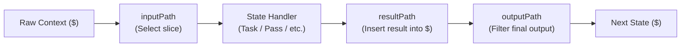

# State Machine Specification

NodeStack Flows are declarative state machines defined as JSON objects. Each flow defines an entry point (`startAt`), execution parameters, and a set of interconnected `states`.

---

## Flow Definition Schema

A top-level flow definition has the following structure:

```json
{
  "comment": "Optional human-readable description of this flow",
  "startAt": "FirstStateName",
  "timeoutSeconds": 300,
  "states": {
    "FirstStateName": { ... },
    "SecondStateName": { ... }
  }
}
```

| Field | Type | Required | Default | Description |
| :--- | :--- | :--- | :--- | :--- |
| `startAt` | `string` | **Yes** | — | Name of the state to execute first. Must match a key in `states`. |
| `states` | `Record<string, FlowState>` | **Yes** | — | Map of state names to their state configurations. |
| `comment` | `string` | No | `""` | Description or notes explaining the flow's purpose. |
| `timeoutSeconds` | `number` | No | `30` | Overall flow execution timeout in seconds. If exceeded, the flow terminates with `timeout` status. |

---

## JSONPath Data Flow: InputPath, ResultPath & OutputPath

Every state receives input data, produces an optional result, and emits output data to the next state. You can shape this data using **JSONPath expressions**:



### 1. `inputPath` (Filter Input)
Selects a subset of the incoming context before the state handler executes.
* Default: `"$"` (passes the entire context object).
* Example: `"inputPath": "$.order"` passes only the `order` object to the state.

### 2. `resultPath` (Place Result into Context)
Determines where the state's execution output is stored within the context.
* Default: `"$"` (replaces the entire context with the state's result).
* If specified as a path (e.g. `"resultPath": "$.payment"`), the state result is added or updated at that key while preserving all other context properties.
* If set to `null`, the state output is discarded, keeping the incoming context unchanged.

### 3. `outputPath` (Filter Output)
Filters the context before passing it to the next state.
* Default: `"$"` (passes the entire merged context).
* Example: `"outputPath": "$.payment.transactionId"` passes only the transaction ID to the subsequent state.

#### Data Flow Example
Given initial context:
```json
{ "user": { "id": "usr_1" }, "cart": { "total": 150 } }
```

State configuration:
```json
{
  "type": "Task",
  "function": "apply-discount",
  "inputPath": "$.cart",
  "resultPath": "$.discount",
  "outputPath": "$",
  "next": "NextStep"
}
```

1. The function receives only `{ "total": 150 }` via `inputPath`.
2. The function returns `{ "rate": 0.10, "saved": 15 }`.
3. With `resultPath: "$.discount"`, the output context becomes:
```json
{
  "user": { "id": "usr_1" },
  "cart": { "total": 150 },
  "discount": { "rate": 0.10, "saved": 15 }
}
```

---

## State Types Reference

### 1. `Task` State
Executes an in-engine **Serverless Function** within a QuickJS WebAssembly sandbox.

```json
{
  "type": "Task",
  "function": "calculate-shipping",
  "elevated": false,
  "serviceRole": false,
  "retry": [
    {
      "errorEquals": ["NetworkError", "503ServiceUnavailable"],
      "intervalSeconds": 1,
      "maxAttempts": 3,
      "backoffRate": 2.0
    }
  ],
  "catch": [
    {
      "errorEquals": ["InvalidAddressError"],
      "resultPath": "$.shippingError",
      "next": "HandleInvalidAddress"
    }
  ],
  "next": "ProceedToCheckout"
}
```

| Field | Type | Required | Description |
| :--- | :--- | :--- | :--- |
| `function` | `string` | **Yes** | The name or ID of the registered serverless function to invoke. |
| `elevated` | `boolean` | No | If `true`, executes the function with elevated database permissions. |
| `serviceRole`| `boolean` | No | If `true`, runs the function with superuser privileges. |
| `retry` | `FlowRetryPolicy[]` | No | List of retry policies for handling transient failures. |
| `catch` | `FlowCatchPolicy[]` | No | List of catch blocks to intercept errors and transition to error handling states. |

#### Retry Policy (`retry`)
* `errorEquals`: Array of error strings or status codes to match. Use `["*"]` or `["States.ALL"]` to match all errors.
* `intervalSeconds`: Initial delay before the first retry (default: `1`).
* `maxAttempts`: Maximum number of retry attempts (default: `3`).
* `backoffRate`: Multiplier by which the retry interval increases on each attempt (default: `2.0`).

#### Catch Policy (`catch`)
* `errorEquals`: Array of error strings to catch.
* `next`: State name to transition to when an error matches.
* `resultPath`: Location in context to store the error object (e.g. `$.error`).

---

### 2. `Choice` State
Adds conditional branching logic based on context variables. The engine evaluates rules sequentially and transitions to the first matching branch.

```json
{
  "type": "Choice",
  "choices": [
    {
      "variable": "$.order.total",
      "numericGreaterThanEquals": 500,
      "next": "ApplyVipDiscount"
    },
    {
      "and": [
        {
          "variable": "$.customer.isNew",
          "booleanEquals": true
        },
        {
          "variable": "$.order.total",
          "numericGreaterThan": 50
        }
      ],
      "next": "ApplyWelcomeBonus"
    }
  ],
  "default": "StandardProcessing"
}
```

#### Comparison Operators

| Operator | Type | Example |
| :--- | :--- | :--- |
| `stringEquals` | `string` | `"stringEquals": "completed"` |
| `numericEquals` | `number` | `"numericEquals": 100` |
| `numericGreaterThan` | `number` | `"numericGreaterThan": 0` |
| `numericGreaterThanEquals` | `number` | `"numericGreaterThanEquals": 50` |
| `numericLessThan` | `number` | `"numericLessThan": 10` |
| `numericLessThanEquals` | `number` | `"numericLessThanEquals": 100` |
| `booleanEquals` | `boolean` | `"booleanEquals": true` |
| `isPresent` | `boolean` | `"isPresent": true` |

#### Compound Logical Operators
* `and`: Array of Choice rules that must all evaluate to true.
* `or`: Array of Choice rules where at least one must evaluate to true.
* `not`: Choice rule that must evaluate to false.

---

### 3. `Map` State
Iterates over an array in the context and executes a sub-state machine for each element.

```json
{
  "type": "Map",
  "itemsPath": "$.order.items",
  "maxConcurrency": 5,
  "resultPath": "$.itemResults",
  "iterator": {
    "startAt": "ValidateItem",
    "states": {
      "ValidateItem": {
        "type": "Task",
        "function": "validate-inventory-item",
        "end": true
      }
    }
  },
  "next": "SummarizeItems"
}
```

| Field | Type | Required | Description |
| :--- | :--- | :--- | :--- |
| `itemsPath` | `string` | **Yes** | JSONPath to the array of items to iterate over. |
| `iterator` | `object` | **Yes** | Sub-state machine definition containing `startAt` and `states`. |
| `maxConcurrency` | `number` | No | Maximum number of items processed concurrently (default: unbounded). |

---

### 4. `Parallel` State
Executes multiple independent branches of states concurrently and aggregates their results into an array.

```json
{
  "type": "Parallel",
  "branches": [
    {
      "startAt": "ProcessInvoice",
      "states": {
        "ProcessInvoice": {
          "type": "Task",
          "function": "generate-invoice-pdf",
          "end": true
        }
      }
    },
    {
      "startAt": "ChargeCustomer",
      "states": {
        "ChargeCustomer": {
          "type": "Task",
          "function": "stripe-charge",
          "end": true
        }
      }
    }
  ],
  "resultPath": "$.parallelResults",
  "next": "OrderComplete"
}
```

---

### 5. `Loop` State
Repeats an execution target while or until a condition evaluates to true.

```json
{
  "type": "Loop",
  "target": "CheckJobStatus",
  "condition": {
    "variable": "$.job.status",
    "stringEquals": "in_progress"
  },
  "maxIterations": 20,
  "next": "JobFinished"
}
```

| Field | Type | Required | Description |
| :--- | :--- | :--- | :--- |
| `target` | `string` | **Yes** | Name of the state to repeat. |
| `condition` | `ChoiceRule` | **Yes** | Condition evaluated on each iteration. |
| `maxIterations` | `number` | No | Safety iteration limit before breaking (default: `100`). |

---

### 6. `Pass` State
Passes its input directly to its output, optionally injecting or transforming data using the `result` property.

```json
{
  "type": "Pass",
  "result": {
    "status": "dry_run_completed",
    "timestamp": "2026-11-02T10:00:00Z"
  },
  "resultPath": "$.mockOutput",
  "next": "Finalize"
}
```

---

### 7. `Wait` State
Pauses execution for a specified number of seconds before transitioning to the next state.

```json
{
  "type": "Wait",
  "seconds": 5,
  "next": "PollStatus"
}
```

---

### 8. `Succeed` State
Terminates the flow execution successfully with status `succeeded`.

```json
{
  "type": "Succeed"
}
```

---

### 9. `Fail` State
Terminates the flow execution with status `failed`.

```json
{
  "type": "Fail",
  "error": "PaymentFailed",
  "cause": "Customer credit card was declined by gateway"
}
```
