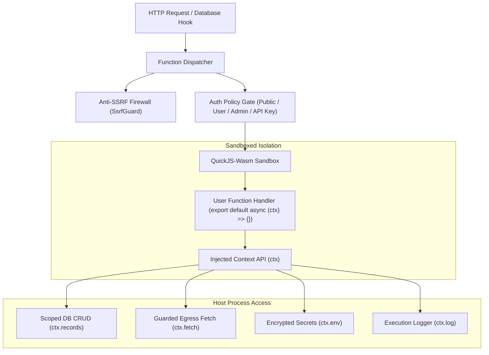

# Serverless Functions (NodeStack Functions)

NodeStack includes an embedded, high-performance **Serverless Functions** subsystem. It enables executing sandboxed JavaScript and TypeScript lambda functions directly within the NodeStack engine without requiring external cloud providers, containers, or third-party infrastructure.

---

## Why In-Engine Serverless Functions?

Traditional serverless architectures (AWS Lambda, Google Cloud Functions, Cloudflare Workers) introduce architectural overhead: cold starts, complex deployment pipelines, external VPC configurations, separate billing, and synchronization delays between database mutations and cloud functions.

NodeStack Functions are executed **in-process within WebAssembly sandboxes** powered by QuickJS:

* **Zero Cloud Dependencies**: No AWS, GCP, Azure, or Docker daemon requirements. Everything runs within your NodeStack process.
* **Instant Cold Starts (&lt;1ms)**: Isolated WebAssembly runtime instances initialize in sub-millisecond time.
* **Hermetic Sandboxing**: Strict memory boundaries, CPU instruction limits, and zero access to host Node.js primitives (`process`, `fs`, `child_process`, or `require`).
* **Dual Triggering System**: Invoke functions directly via HTTP endpoints (`ANY /api/functions/:name/invoke`) or bind them synchronously to **Database Lifecycle Hooks** (`<collection>:<phase><Action>`).
* **Dedicated Admin Workbench**: Built-in CodeMirror IDE with TypeScript/JavaScript syntax highlighting, Eclipse (light) and Dracula (dark) theme switching, a collapsible Context API (`ctx`) cheatsheet, a live sandbox test runner, and execution logs.
* **Multi-Tenancy Aware**: Scoped cleanly to individual application tenants (`/api/apps/:slug/functions/...`) with isolated env secrets and separate databases.

---

## Architecture & Isolation (QuickJS-Wasm)

Every function invocation creates an ephemeral, isolated QuickJS virtual machine:



### Safety & Resource Boundaries

1. **CPU Execution Timeout**: Configurable from 100ms to 15,000ms (default 1,000ms). Infinite loops or suspended promises are automatically aborted with `HTTP 504 Gateway Timeout` without blocking the Node.js event loop.
2. **Memory Quotas**: Configurable from 4MB to 128MB (default 32MB). Out-of-memory states safely terminate only the specific sandbox instance.
3. **Anti-SSRF Network Protection**: All outbound network requests through `ctx.fetch()` are filtered through NodeStack's network firewall, blocking loopback addresses, private subnets, and cloud metadata APIs.

---

## Function Handler Signature

Functions must export a default async function that accepts a single `ctx` execution parameter:

```javascript
export default async function(ctx) {
  ctx.log("Invoked function in tenant:", ctx.app.slug);

  const name = ctx.request.body.name || "World";

  return {
    status: 200,
    headers: {
      "x-custom-engine": "nodestack-quickjs"
    },
    body: {
      message: `Hello, ${name}!`,
      timestamp: new Date().toISOString()
    }
  };
}
```

### Return Value Format

The function return value controls the HTTP response:

| Property | Type | Default | Description |
| :--- | :--- | :--- | :--- |
| `status` | `number` | `200` | HTTP response status code (e.g. `200`, `201`, `400`, `403`). |
| `headers` | `Record<string, string>` | `{}` | Optional custom response HTTP headers. |
| `body` | `any` | `null` | Response payload (JSON object, array, string, or boolean). |

If an uncaught exception is thrown or an error occurs inside the sandbox, NodeStack returns `HTTP 500` with the sanitized error message and records the trace in the execution logs.

---

## HTTP Invocations

Every function receives a direct invocation route corresponding to its unique identifier name:

### Default Application
```http
ANY /api/functions/:name/invoke
```

### Multi-Tenant Application
```http
ANY /api/apps/:slug/functions/:name/invoke
```

Alternatively, pass the `x-nodestack-app: <slug>` header to route invocations directly to tenant applications.

### Supported HTTP Methods
Functions support all standard HTTP verbs: `GET`, `POST`, `PUT`, `PATCH`, and `DELETE`. You can configure allowed methods per function in the Configuration tab.

---

## Admin UI Dedicated Workbench

NodeStack provides a full-featured workbench for designing, testing, and managing serverless functions directly in your browser:

* **Create New Function**: Navigate to `/_/functions/new` (or click **New Function**).
* **Edit Existing Function**: Navigate to `/_/functions/:name` (or click on any function in the table).

The workbench is divided into 4 specialized tabs:

1. **Code & Context Reference**:
   * **Full-Width CodeMirror IDE**: Line numbers, bracket matching, indentation management, and `Ctrl+S` / `Cmd+S` shortcuts.
   * **Real-time Syntax Highlighting**: Dual-theme support matching your active workspace theme (Eclipse for light mode, Dracula for dark mode).
   * **Starter Recipes**: 1-click templates for Cart Discounts, Stripe Checkout, Lifecycle Hooks, and External API Fetch.
   * **Interactive Context API Cheatsheet**: Searchable, categorized documentation of all `ctx` properties with 1-click snippet insertion into your code.
2. **Live Test Runner**:
   * Simulate HTTP requests with custom verbs (`POST`, `GET`, etc.), request headers, auth tokens, and JSON payloads.
   * Run isolated tests and inspect HTTP status codes, latency duration, captured `ctx.log` output, response bodies, and response headers.
3. **Configuration & Triggers**:
   * Configure immutable slug names, descriptions, auth policies (`public`, `auth`, `admin`, `apiKey`), execution limits, SSRF whitelists, elevated permissions, and encrypted `ctx.env` secrets.
4. **Function Logs & History**:
   * Real-time inspection of past executions, caller identities, durations, status codes, and input/output payload details.

---

## Starter Recipes

### 1. Cart Discount Calculator
```javascript
// Calculate cart discounts with RuleEngine access preserved
export default async function(ctx) {
  const { cartTotal, couponCode } = ctx.request.body;
  let discountRate = 0;

  if (couponCode === "SAVE20") {
    discountRate = 0.20;
  } else if (couponCode === "VIP50" && ctx.request.auth) {
    discountRate = 0.50;
  }

  const discount = (cartTotal || 0) * discountRate;
  const finalTotal = Math.max(0, (cartTotal || 0) - discount);

  return {
    status: 200,
    headers: { 'x-applied-rate': (discountRate * 100) + '%' },
    body: {
      originalTotal: cartTotal,
      discount: discount,
      finalTotal: finalTotal
    }
  };
}
```

### 2. External API Integration (SSRF-Guarded)
```javascript
// Fetch exchange rates from an external API safely
export default async function(ctx) {
  const res = await ctx.fetch('https://api.exchangerate.host/latest?base=USD');
  const data = await res.json();

  return {
    status: 200,
    body: {
      rates: data.rates,
      syncedAt: new Date().toISOString()
    }
  };
}
```
