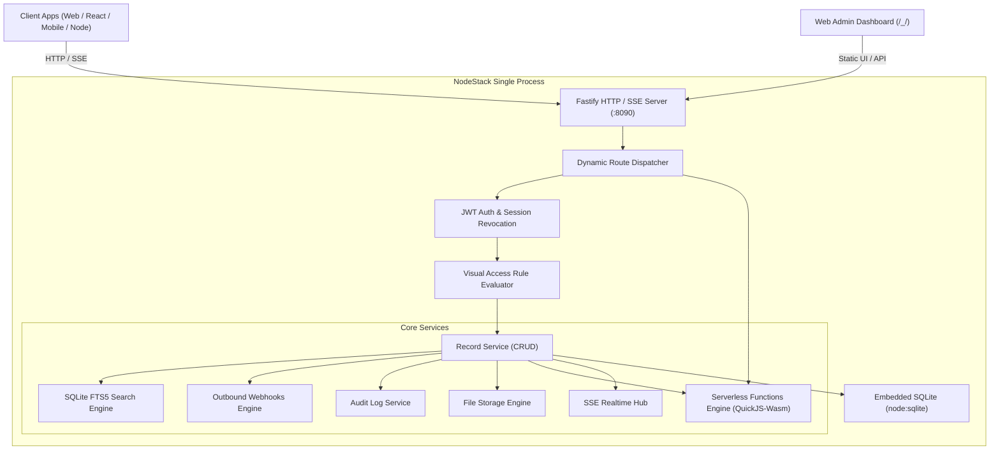

Overview & Architecture

> **The TypeScript-Native Embedded Backend Stack**  
> A self-hosted, single-process Backend Stack built natively for Node.js and TypeScript.

NodeStack provides an instant, production-grade backend engine with embedded SQLite, automatic REST CRUD APIs, JWT authentication, real-time Server-Sent Events (SSE), multipart file storage, SQLite FTS5 full-text search, outbound webhooks, immutable audit logs, and an embedded Web Admin dashboard.

---

Why NodeStack?

Building modern web and mobile apps often requires juggling separate database engines, Redis caches, authentication servers, cloud storage buckets, and boilerplate CRUD route handlers.

NodeStack packages this entire backend architecture into a **single Node.js process**:

- **Embedded SQLite with Zero Native Compilation**: Powered directly by Node.js (`node:sqlite`). No Python, C++ compilers, or external database daemon installations required.
- **Multi-Application Platform**: Host multiple completely isolated application tenants within a single process—with separate SQLite databases, file storage directories, auth collections, and realtime SSE buses.
- **Instant REST CRUD & Server-Sent Events (SSE)**: Immediately exposes JSON endpoints and realtime change event streams for every collection.
- **Embedded Web Admin Dashboard**: A responsive dashboard served directly from `http://localhost:8090/_/` without needing an external web server.
- **Application Snapshots & Checkpoints**: Atomic transactional state checkpoints, non-destructive rollbacks, and live schema drift detection.
- **Themed Admin Portal**: Instant runtime switching between System, Light, and Dark modes with zero-flicker loading.
- **Native SQLite FTS5 Full-Text Search**: High-performance BM25 relevance ranking, keyword prefix matching, and contextual snippet highlighting.
- **Embedded Serverless Functions (v2.1)**: Run isolated JavaScript/TypeScript lambdas in WebAssembly with sub-millisecond cold starts, Anti-SSRF network firewalls, direct HTTP routes, database lifecycle hooks, and a dedicated CodeMirror IDE workbench.
- **Outbound Webhooks Subsystem**: Trigger-based HTTP dispatch with HMAC-SHA256 signature verification and automated retries.
- **Immutable Audit Logging**: Field-level `{ old, new }` diff computation, actor attribution, sensitive field masking, and visual record timeline.
- **Built-in Authentication & File Storage**: JWT tokens, bcrypt password hashing, auth collections (`users`), and multipart file uploads with MIME validation.
- **End-to-End TypeScript Type Safety**: One-command type generation (`nodestack typegen`) and live HTTP type exports (`GET /_/types.d.ts`).
- **Interactive OpenAPI 3.0 Documentation**: Live Scalar and Swagger UI API documentation and dynamic spec generation at `/_/docs`.
- **First-Party Client SDK (`nodestack-client`)**: Lightweight (`< 10KB`), zero-dependency TypeScript/JavaScript client for web, mobile, React, Next.js, Bun, and Node.js.
- **Clean Inversion of Control (IoC)**: Built with Clean Architecture, Inversion of Control container, and SOLID principles.

---

️ Architecture Overview

NodeStack is structured into clear architectural layers:



### Storage on Disk

NodeStack stores all data inside a single directory (`./nodestack_data` by default):

```
nodestack_data/
├── data.db          # Primary SQLite database file (WAL mode enabled)
├── data.db-shm      # SQLite shared-memory file
├── data.db-wal      # SQLite write-ahead log file
└── storage/         # Uploaded multipart binary files
```

Moving, snapshotting, or backing up your backend is as simple as copying this folder.
