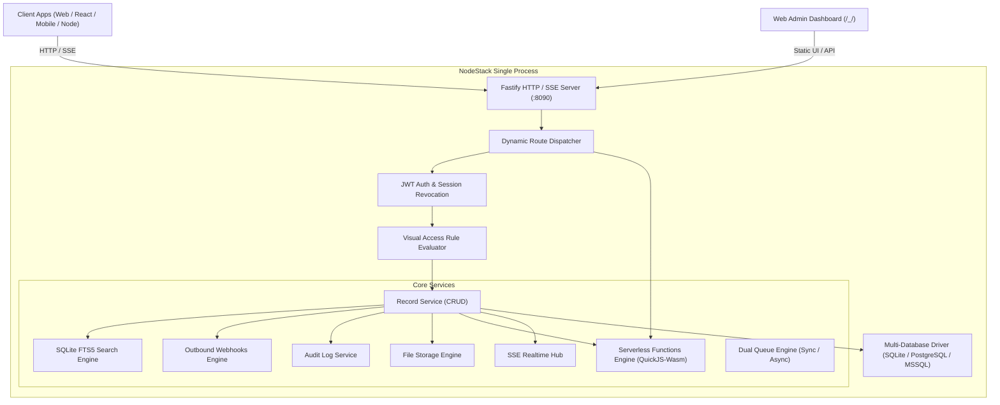

Overview & Architecture

> **The TypeScript-Native Embedded Backend Stack**  
> A self-hosted, single-process Backend Stack built natively for Node.js and TypeScript.

NodeStack provides an instant, production-grade backend engine with embedded SQLite, automatic REST CRUD APIs, JWT authentication, real-time Server-Sent Events (SSE), multipart file storage, SQLite FTS5 full-text search, outbound webhooks, immutable audit logs, and an embedded Web Admin dashboard.

---

Why NodeStack?

:::tip Architectural Comparison
Looking for an objective comparison of **NodeStack vs. PocketBase vs. Supabase**? Check out our comprehensive [**NodeStack vs. Alternatives**](./comparison.md) guide.
:::

Building modern web and mobile apps often requires juggling separate database engines, Redis caches, authentication servers, cloud storage buckets, and boilerplate CRUD route handlers.

NodeStack packages this entire backend architecture into a **single Node.js process**:

- **Built-in Job Scheduler & Cron Engine (v2.7.0)**: App-scoped recurring task execution with 5-field cron syntax, standard macros, priority timer wheel, missed-run catchup policies (`skip`, `catch_up_once`, `catch_up_all`), and native multi-target dispatching to Functions, Flows, and Snapshots.
- **Fail-Closed Multi-Database Resilience (v2.7.0)**: Strict fail-closed partition protection preventing split-brain corruption during network unreachability, dynamic external driver resolution (`DriverPackageLoader`), and safe migration target validation.
- **Unified RBAC Engine & Permissions Tester (v2.6.0)**: Granular role-based and scope-based authorization across collections, records, flows, and serverless functions with automatic wildcard stripping on role downgrades, atomic quota enforcement, and built-in interactive permission testing tools in the Admin UI, CLI, and client SDK.
- **Hardened Plugin Sandboxing (PoLP) (v2.6.0)**: Principle of Least Privilege plugin DI containers, safe service token allowlists, tenant configuration isolation, and fault-tolerant EventBus error boundaries.
- **Multi-Database Support**: Native engine support for **PostgreSQL**, **Microsoft SQL Server**, and embedded **SQLite**, with zero-downtime live migrations, dynamic driver switching, per-schema storage tracking, and dual sync/async queue execution.
- **Embedded SQLite with Zero Native Compilation**: Powered directly by Node.js (`node:sqlite`). No Python, C++ compilers, or external database daemon installations required.
- **Multi-Application Platform**: Host multiple completely isolated application tenants within a single process—with separate database schemas, file storage directories, auth collections, and realtime SSE buses.
- **Instant REST CRUD & Server-Sent Events (SSE)**: Immediately exposes JSON endpoints and realtime change event streams for every collection.
- **Embedded Web Admin Dashboard**: A responsive dashboard served directly from `http://localhost:8090/_/` without needing an external web server.
- **Application Snapshots & Checkpoints**: Atomic transactional state checkpoints, non-destructive rollbacks, and live schema drift detection.
- **Themed Admin Portal**: Instant runtime switching between System, Light, and Dark modes with zero-flicker loading.
- **Native Full-Text Search (FTS)**: Multi-engine BM25 relevance ranking and snippet highlights supporting SQLite FTS5, PostgreSQL `to_tsvector`, and MSSQL `CONTAINSTABLE`.
- **Embedded Serverless Functions**: Run isolated JavaScript/TypeScript lambdas in WebAssembly with sub-millisecond cold starts, Anti-SSRF network firewalls, direct HTTP routes, database lifecycle hooks, and a dedicated CodeMirror IDE workbench.
- **Serverless Function Flows**: In-engine visual state machine workflow orchestration with drag-and-drop designer, declarative Code DSL, 9 state types, database lifecycle triggers, flow concurrency throttling, and referential integrity protection.
- **NodeStack Queues Subsystem**: Transactional message queuing with atomic claiming, configurable retries, Dead-Letter Queues (DLQ), strict partition FIFO ordering, serverless function binding, and dual Sync/Async queue engines.
- **Outbound Webhooks Subsystem**: Trigger-based HTTP dispatch with HMAC-SHA256 signature verification and automated retries.
- **Immutable Audit Logging**: Field-level `{ old, new }` diff computation, actor attribution, sensitive field masking, and visual record timeline.
- **Built-in Authentication & File Storage**: JWT tokens, bcrypt password hashing, auth collections (`users`), and multipart file uploads with MIME validation.
- **End-to-End TypeScript Type Safety**: One-command type generation (`nodestack typegen`) and live HTTP type exports (`GET /_/types.d.ts`).
- **Interactive OpenAPI 3.0 Documentation**: Live Scalar and Swagger UI API documentation and dynamic spec generation at `/_/docs`.
- **First-Party Client SDK (`nodestack-client`)**: Lightweight (`< 10KB`), zero-dependency TypeScript/JavaScript client for web, mobile, React, Next.js, Bun, and Node.js.
- **Clean Inversion of Control (IoC)**: Built with Clean Architecture, Inversion of Control container, and SOLID principles.

---

## 🏛️ Architecture Overview

<p align="center">
  
</p>

NodeStack is structured into clear architectural layers:



### Storage on Disk

NodeStack stores all data inside a single directory (`./nodestack_data` by default):

```
nodestack_data/
├── data.db          # Primary SQLite database file (WAL mode enabled)
├── data.db-shm      # SQLite shared-memory file
├── data.db-wal      # SQLite write-ahead log file
└── storage/         # Uploaded multipart binary files
```

Moving, snapshotting, or backing up your backend is as simple as copying this folder.
