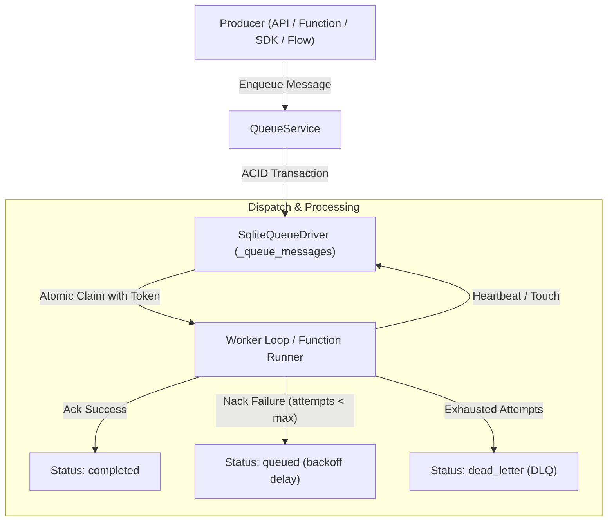

# NodeStack Queues

NodeStack includes an embedded, durable **Queues Subsystem**. It provides transactional background job processing and message queuing directly inside the NodeStack engine—without requiring Redis, RabbitMQ, SQS, or external queue infrastructure.

---

## Why In-Engine Queues?

Modern applications rely on background job queues for time-consuming or asynchronous tasks:
* **Email & Push Notifications**: Offloading transactional emails, SMS, and webhook notifications from the main HTTP request loop.
* **Media & File Processing**: Image transcoding, PDF rendering, and document extraction.
* **Data Ingestion & Webhooks**: Absorbing bursty inbound webhook traffic without dropping requests.
* **Strict Sequential Processing**: Processing accounting ledgers, inventory deductions, or financial transactions in strict chronological order per customer or account.
* **Workflow Throttling**: Regulating concurrent executions for state machines (**Function Flows**) so heavy workloads don't starve host resources.

NodeStack Queues delivers:
* **Zero Infrastructure Overhead**: Runs natively on your embedded SQLite database (`_queues` and `_queue_messages` tables) with full ACID transaction guarantees.
* **Atomic Job Claiming**: Lock-free atomic claims with lease expiration, heartbeat renewal (`touch`), and automatic orphan worker recovery on crash or server restart.
* **Strict FIFO Partition Ordering**: Use `groupKey` (partition key) to ensure messages in the same partition execute strictly in order, with automatic partition suspension on failure until resolved.
* **Serverless Function Binding**: Automatically binds queues to QuickJS WebAssembly serverless functions (`targetFunction`) for fully managed, zero-code event consumer execution.
* **Dead-Letter Queues (DLQ)**: Automatic isolation of persistently failing messages after `maxAttempts` with single-click manual retry and re-drive capabilities.
* **Visual Admin UI**: Live monitoring dashboard with real-time throughput metrics, job state filters (`queued`, `processing`, `completed`, `failed`, `dead_letter`), payload drawers, and manual re-queue controls.
* **Multi-Tenant Isolation**: Queues are scoped per tenant application (`/api/apps/:slug/queues`).

---

## Architecture & Storage Model

### Database Tables
NodeStack stores queues and job states inside internal system tables:
* `_queues`: Stores queue configurations (name, concurrency limits, lease visibility timeout, retry policies, target function, strict ordering flag).
* `_queue_messages`: Stores durable job payloads, statuses, partition group keys, attempt counters, expiration leases, and cryptographic claim tokens.

---

## Queue Configuration

Each queue can be configured with specific concurrency and failure handling parameters:

| Property | Type | Default | Description |
| :--- | :--- | :--- | :--- |
| `name` | `string` | *(Required)* | Unique name for the queue. |
| `concurrency` | `number` | `1` | Maximum number of concurrent jobs actively processing at any given time. |
| `visibilityTimeoutSeconds` | `number` | `30` | Duration (in seconds) a claimed message is locked for a worker before becoming eligible for reclaim. |
| `maxAttempts` | `number` | `3` | Maximum retry attempts before routing the message to a Dead-Letter Queue (DLQ). `0` indicates infinite retries. |
| `backoffDelayMs` | `number` | `1000` | Base exponential backoff delay (in milliseconds) applied between retry attempts. |
| `deadLetterQueue` | `string \| null` | `null` | Name of the destination DLQ for exhausted messages. Defaults to `null` (marked as `dead_letter` in place). |
| `targetFunction` | `string \| null` | `null` | Optional serverless function name or ID bound to consume messages automatically. |
| `strictOrder` | `boolean` | `false` | When `true`, enforces strict sequential FIFO processing per `groupKey`. |

---

## Strict FIFO Partition Ordering

When `strictOrder: true` is enabled, the queue behaves as a partitioned FIFO queue:
1. **Partitioning with `groupKey`**: Every message with the same `groupKey` (e.g. `account:acc_123` or `order:ord_987`) belongs to an isolated sequential partition.
2. **Head-of-Line Guarantee**: A message in partition `P` will **never** be dispatched if an earlier message in partition `P` is currently in progress (`processing`) or has failed with pending retries.
3. **Partition Independence**: Different partitions process completely concurrently up to the queue's configured `concurrency` limit without cross-partition head-of-line blocking.
4. **Failure Handling**: If a message in a strict-order partition encounters an error, the partition halts until the message succeeds on retry, is moved to the DLQ, or is manually skipped via `forceSkip()`.

---

## System Queues vs. User Queues

NodeStack distinguishes between user-created queues and internal system queues:
* **User Queues**: Created by developers to manage application-level background jobs (e.g. `emails`, `image-resizing`, `webhooks-outbound`).
* **System Queues (prefixed with `_`)**: Managed automatically by internal NodeStack engines. For instance, **Function Flows** uses dedicated queues (`_flow_{flowId}`) to enforce execution concurrency throttling.
* **Security Guard**: System queues are shielded from unauthorized guest access, unprivileged function invocations, and accidental manual purges.
